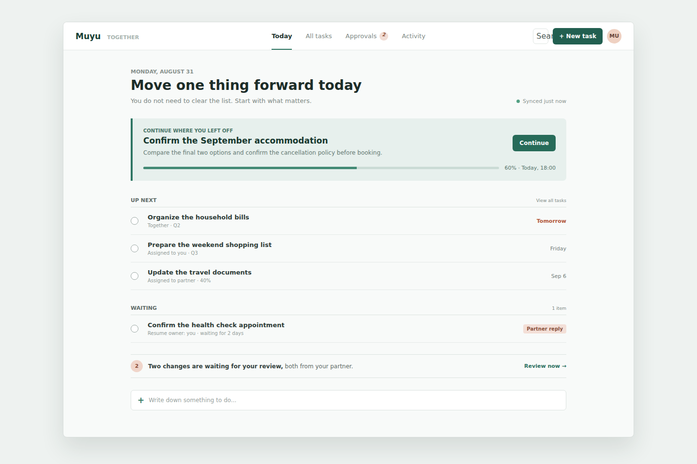

# Web 前端视觉方向设计规格

## 1. 状态与范围

本规格固定 Muyu Web 前端的视觉与交互风格，作为后续 React 架构设计、页面重构、组件开发和 Windows 适配的共同视觉合同。

已确认的产品方向是：Web 主要面向桌面浏览器，是一个没有管理员角色的双人行动管理工具，不采用传统后台管理系统的视觉语言。视觉方案采用已评审原型中“安静留白”和“柔和生活感”的融合方向，关键词为：

> 安静，但不冷淡；简洁，但不空洞；有生活感，但不幼稚。



上图是已确认融合原型的静态视觉基准。图中的英文仅用于保证跨环境截图字体稳定；正式产品继续使用中文界面。后续页面可以调整业务内容，但必须保留其顶部轻导航、居中内容宽度、唯一重点区域、线性任务行和深绿加珊瑚色关系。

本规格固定：

- 产品气质、页面骨架和视觉层级；
- 颜色、字体、间距、圆角和基础控件规则；
- “今天”行动工作台的首屏构成；
- 任务、审批、同步和错误状态的通用表现；
- 桌面浏览器和未来 Windows 壳层的适配原则；
- 明确禁止的后台化和装饰性模式。

本规格不定义完整任务详情信息架构、后端 API 变更、React 目录结构、Windows 打包技术选型或每个业务页面的最终功能范围。这些内容必须在后续架构设计和实施计划中确认，但不得偏离本规格的视觉方向。

## 2. 产品心智模型

Web 首屏不是数据总览、统计大屏或管理控制台，而是一份每天愿意打开的私人行动清单。首屏首先回答：

1. 现在最值得继续推进的是哪一件事；
2. 接下来还有哪些可以开始的行动；
3. 哪些事情正在等待或阻塞；
4. 是否有来自伙伴的变更需要确认。

系统游标、版本、冲突数量和同步细节属于必要状态，不应成为首屏视觉中心。只有在错误、冲突或用户主动查看时才提高其视觉权重。

完整任务列表、审批和动态仍是独立入口，但“今天”是默认入口。用户不需要先理解状态统计或项目结构才能开始行动。

## 3. 视觉原则

### 3.1 留白组织内容

页面主要依靠排版、分组标题、细分隔线和稳定间距建立层级，不依靠大量卡片、阴影或彩色容器切割页面。

任务列表使用线性行布局。普通任务行不得包进独立卡片；同一页面不得出现卡片套卡片。页面内容区保持稳定宽度，让视线自然停留在行动内容上。

### 3.2 颜色传达状态而非装饰

深绿色表达品牌、当前选择和主要动作；浅绿色只用于唯一重点任务或正向状态；珊瑚色用于临期、等待、审批和需要注意的内容。

颜色不能代替文字。阻塞、等待、错误和审批必须同时有明确文案或图标。页面不使用渐变、装饰色块、光晕、玻璃拟态或大面积单一彩色背景。

### 3.3 有温度的克制文案

文案直接、自然，强调行动而不是管理。例如：

- “今天，先让一件事向前走”；
- “不用清空列表，完成真正重要的一步就好”；
- “有两个变更等你确认”。

避免“数据概览”“管理中心”“工作台指标”“任务资产”等后台管理措辞，也避免游戏化、说教、评分或鼓励式口号。

### 3.4 桌面效率不等于高密度

桌面版支持清晰的悬停、焦点、键盘操作和快速创建，但不把所有信息同时铺满屏幕。默认密度为舒适紧凑：一屏可以扫描主要行动，同时保持可辨认的分组和点击区域。

## 4. 页面骨架

### 4.1 顶部应用栏

Web 使用单层顶部应用栏，不使用固定深色侧栏。

应用栏固定包含：

- 左侧品牌“木鱼 / MUYU”；
- 中部一级导航：“今天”“所有任务”“审批”“动态”；
- 右侧搜索、新建任务和当前用户入口。

当前导航使用文字颜色和底部 `2px` 指示线，不使用大面积胶囊背景。审批数量使用小型计数徽标。应用栏建议高度 `56-60px`，背景为白色，与页面之间使用一条浅色分隔线。

设置、Web 会话和退出登录放在用户菜单中，不与日常任务入口竞争。

### 4.2 内容容器

桌面内容容器建议最大宽度 `900-960px`，在窗口中水平居中。常规页面左右内边距为 `24-32px`，顶部内容间距为 `32-40px`。

超宽显示器不得把任务行无限拉宽，也不得为了填满空间增加无意义的统计栏或右侧信息卡。空余空间是设计的一部分。

### 4.3 “今天”首屏

首屏按以下顺序展示：

1. 日期、页面标题和一句简短辅助文案；
2. 低权重同步状态；
3. 最多一个“继续上次的任务”重点区域；
4. “接下来”线性任务列表；
5. “等待中”线性任务列表；
6. 内联审批提醒；
7. 快速记录入口。

首屏不展示 KPI 卡片、图表、任务总数矩阵或五列状态看板。没有重点任务时直接省略重点区域，不显示空卡片。

### 4.4 重点任务区域

重点任务是页面唯一允许使用浅色背景强调的大块区域。它使用浅绿色背景、左侧 `4px` 深绿强调线和不超过 `8px` 的圆角。

区域显示任务标题、一句下一步描述、负责人、截止时间和进度。只保留一个明确主操作，例如“继续处理”。不在区域内堆叠多个同权按钮。

重点任务由明确的产品规则选出，不能仅因最近更新时间变化而随机跳动。具体选择规则在行动工作台功能设计中定义。

### 4.5 任务行

普通任务行建议高度 `52-60px`，使用三列结构：

```text
[完成控件] [标题 + 辅助信息] [截止时间或状态]
```

标题保持一行优先；辅助信息包含负责人、象限、标签或进度中的必要部分。截止时间、等待和临期状态位于行尾，避免把标题挤成狭窄列。

任务行通过底部分隔线区分，悬停时只使用轻微中性或浅绿色背景。悬停、加载、徽标和图标不得改变行高或导致列表跳动。

### 4.6 审批提醒

首屏审批使用一条横向内联提醒，不使用独立仪表盘卡片。提醒包含数量、自然语言说明和“去处理”入口。

完整审批页面仍可使用重复请求项，但每一项只表达一个审批对象，不使用嵌套卡片。批准、拒绝和取消必须保持明显的动作层级和处理中状态。

## 5. 设计令牌

### 5.1 颜色

首版只实现亮色主题。以下颜色是基线值，实施时可在可访问性校验范围内微调，但不得改变整体色相关系。

| 用途 | 基线值 | 说明 |
| --- | --- | --- |
| 页面背景 | `#F8FAF9` | 带少量绿色倾向的冷白，不使用米黄底色 |
| 主表面 | `#FFFFFF` | 顶栏、输入框和必要浮层 |
| 主文字 | `#1D2D29` | 标题和主要任务文字 |
| 正文文字 | `#25312E` | 普通正文 |
| 次级文字 | `#7C8783` | 日期、说明和元数据 |
| 品牌主色 | `#225F50` | 主按钮和品牌文字 |
| 交互绿色 | `#2E7663` | 当前导航、焦点和进度 |
| 浅绿强调 | `#E7F0ED` | 唯一重点任务区域 |
| 珊瑚提示 | `#B2573B` | 临期和需要注意的文字 |
| 浅珊瑚背景 | `#F3DFD7` | 等待、审批和温和警示 |
| 分隔线 | `#DCE3E0` | 页面和任务行边界 |
| 同步正常 | `#52A083` | 低权重同步状态点 |

错误状态应使用可访问的红色文字和浅红背景，不复用珊瑚提示色掩盖错误严重程度。

### 5.2 字体

字体栈固定为：

```css
font-family: Inter, "Segoe UI", ui-sans-serif, system-ui, sans-serif;
letter-spacing: 0;
```

Windows 壳层优先自然回退到 `Segoe UI`。首版不引入装饰字体或衬线字体。

建议字号层级：

| 层级 | 字号 / 行高 | 字重 |
| --- | --- | --- |
| 页面标题 | `28px / 34px` | `700` |
| 重点任务标题 | `17px / 24px` | `700` |
| 任务标题 | `13-14px / 20px` | `600` |
| 正文 | `13px / 20px` | `400` |
| 次级信息 | `11-12px / 16px` | `400-600` |
| 分组标签 | `11px / 16px` | `700` |

字号不随 viewport 宽度连续缩放。

### 5.3 间距、圆角和阴影

使用 `4px` 基础间距体系，常用值为 `4 / 8 / 12 / 16 / 24 / 32 / 40`。

- 普通控件圆角：`6px`；
- 面板和浮层最大圆角：`8px`；
- 状态徽标可使用小型胶囊圆角；
- 文本命令不得无理由放入圆角胶囊；
- 页面区块默认不使用阴影；
- 菜单、弹窗和抽屉只使用一层轻阴影表达浮层关系。

## 6. 控件与交互

- 图标统一使用 Lucide，不手绘 SVG，不混用多套图标风格；
- 搜索、关闭、刷新和更多操作优先使用熟悉图标，并提供 tooltip 和可访问名称；
- 主要文字按钮每个区域最多一个；次要操作使用中性按钮或菜单；
- 二元设置使用开关或复选框，模式切换使用分段控件，选项集合使用菜单或选择器；
- 所有异步操作显示局部处理中状态，不能用整页重新渲染造成闪烁；
- 成功写入优先通过界面状态变化确认，避免为每次普通操作弹出 toast；
- 错误应靠近触发位置展示，并保留用户已经输入的内容；
- 焦点样式使用品牌绿色外环，不能只依赖颜色很浅的边框；
- 动画时长控制在 `120-180ms`，只用于悬停、展开、抽屉和状态过渡；
- 尊重 `prefers-reduced-motion`，禁止装饰性循环动画。

## 7. 状态表达

### 7.1 同步

同步正常时只显示小型绿色状态点和“刚刚同步”等文案。WebSocket 重连属于内部机制，不能持续打扰用户。

同步失败且已有快照时，页面继续显示快照，并在页面标题附近展示明确的“内容可能不是最新”状态。认证失效直接进入登录流程，不能继续把可编辑界面伪装成在线状态。

### 7.2 空状态

空状态使用一句解释和一个明确动作，不使用大型插画、营销文案或装饰卡片。例如“今天没有需要处理的任务”配合“记下一件事”。

### 7.3 等待、审批和冲突

- 等待：浅珊瑚背景或珊瑚文字，并说明正在等待什么；
- 审批：显示对象、来源和动作，不把审批包装成统计指标；
- 冲突：使用独立的高优先级警示和清晰的两个解决动作，不能仅显示版本号；
- 已完成：降低文字权重，可显示完成标记，但历史内容仍可读取。

## 8. 桌面与 Windows 适配

Web 首要验收视口为 `1280x720`、`1440x900` 和 `1920x1080`。在超宽屏上保持内容最大宽度，不增加无意义栏目。

浏览器宽度低于 `1024px` 时，可以收紧内容边距并把次要导航收入菜单，但必须保持核心任务可操作。移动 Web 只要求基础响应式可用，不与 Android 原生客户端争夺完整移动体验。

未来 Windows 版本应复用相同 React 页面和设计令牌，通过独立平台适配层提供窗口、通知、深链或系统菜单能力。业务组件不得直接依赖桌面壳层 API。当前 Web 不模拟 Windows 标题栏，也不提前选择 Electron 或 Tauri。

桌面交互应预留键盘操作能力，但界面不展示大段快捷键说明。快捷键名称只在菜单或 tooltip 中按需出现。

## 9. 明确禁止的模式

后续页面不得采用以下设计：

- 固定深色管理侧栏；
- 首页 KPI 卡片、统计矩阵或装饰图表；
- 五列状态看板作为默认首屏；
- 卡片套卡片或每个任务一个浮动大卡片；
- 大面积渐变、玻璃拟态、光晕、圆形色块或背景装饰；
- 过大的营销式标题、Hero 区域和功能介绍文案；
- 以系统游标、版本号和内部 ID 作为普通用户的主要信息；
- 只有颜色、没有文字或图标的状态表达；
- 为填满桌面宽度而增加无实际操作价值的边栏；
- 负字距、随视口缩放字号和超过 `8px` 的通用卡片圆角。

## 10. 验收标准

视觉重构完成后必须满足：

1. 首屏默认进入“今天”，并按照重点任务、接下来、等待、审批提醒和快速记录的顺序展示；
2. 页面没有固定管理侧栏、KPI 卡片或默认看板；
3. 普通任务使用稳定高度的线性行，不因悬停、加载或徽标发生布局跳动；
4. 所有颜色、字体、间距和圆角通过集中设计令牌提供，不在业务组件中散落硬编码主题值；
5. 主要文字与背景对比度至少达到 WCAG AA，键盘焦点完整可见；
6. `1280x720`、`1440x900` 和 `1920x1080` 下无横向溢出、文字遮挡或操作重叠；
7. Playwright 截图覆盖“今天”、所有任务、审批、任务详情和二维码登录的主要状态；
8. 视觉回归检查确认页面保持“安静留白 + 柔和生活感”的方向；
9. 断网、同步过期、认证失效、空列表、等待、审批和冲突状态都有明确且稳定的表现；
10. 未来 Windows 壳层接入不要求业务组件重写视觉结构或直接调用平台 API。

本规格是后续 Web 前端设计的强约束。若实施中需要改变顶部导航、首屏层级、主色关系或禁止模式，必须先更新本规格并重新确认，不能在组件开发中自行偏移风格。
